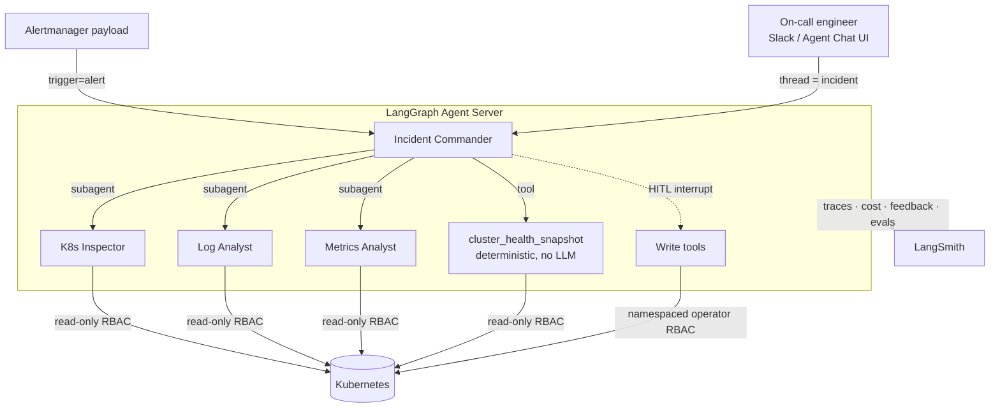

# SRE Agent

A multi-agent SRE assistant for Kubernetes, built with **LangChain v1 + LangGraph**, **Claude** and **LangSmith**.

An alert (or a question in Slack / a chat UI) starts an investigation. An **Incident Commander** gets a deterministic cluster snapshot, delegates to read-only specialists (**K8s Inspector**, **Log Analyst**, **Metrics Analyst**) and proposes a remediation. **Nothing changes in the cluster without a human:** operational actions (rollback, restart, scale) need approval with a mandatory justification; configuration changes (image, resources, env) are drafted as a change request for the owning team, never applied.

> **Status:** working proof of concept on a local cluster, evaluated against reproducible failure scenarios. It has not run in production. Current work moves it toward a production-shaped setup (see [Roadmap](#roadmap)).

## Contents
- [How it works](#how-it-works)
- [Safety by design](#safety-by-design)
- [Measured results](#measured-results)
- [Quickstart](#quickstart)
- [Repository layout](#repository-layout)
- [Design decisions](#design-decisions)
- [Roadmap](#roadmap)

## How it works



1. **Trigger.** An Alertmanager webhook (`make alert-bad-rollout`) or a Slack mention starts a run. Alert text is treated as untrusted data.
2. **Triage.** The commander first calls `cluster_health_snapshot`: domain logic in plain Python that summarizes unhealthy pods, stalled rollouts and node pressure in ~1.3k tokens (vs ~36.7k for raw `kubectl` output).
3. **Delegation.** Specialists (Claude Haiku) work in isolated contexts with 3–8 tools each and return a structured report (findings, suspected cause, confidence). Raw tool output never reaches the commander.
4. **Proposal.** The commander (Claude Sonnet) writes an incident summary: status, impact, probable cause, evidence, next steps.
5. **Approval.** Write tools pause the graph (`interrupt_on`). In Slack, the on-call sees the diff and the `Why:` and clicks Approve/Reject; the action runs with dry-run, waits for the rollout, verifies and is audited.
6. **After the incident.** A blameless postmortem draft (facts from the thread and audit log, prose from one Haiku call) is posted in the Slack thread, with 👍/👎 feedback sent to LangSmith.

## Safety by design
- **Two identities:** cluster-wide read-only for investigation; a namespaced `operator` role with short-lived tokens for approved actions. Specialists have no write tools (enforced by tests).
- **Every write is human-approved** and carries a mandatory `justification` (schema-level, not just prompt).
- **Configuration changes are routed, not applied.** The agent drafts a change request (manifest diff + evidence) meant to become a GitOps PR it never merges; unverifiable values stay as placeholders.
- **Untrusted inputs:** logs, events and alerts are wrapped as data; secrets are redacted; the agent cannot read `Secret` objects.
- **Scope guard:** off-topic requests are refused in one line; API refusals are isolated so they don't poison the rest of the thread.
- **Hard budget:** every model goes through one factory with a monthly spend cap.

## Measured results
Evaluated with a LangSmith dataset of 11 reproducible cases: six injected failures (crashloop, OOMKilled, ImagePullBackOff, Pending, CPU throttling, bad rollout), a healthy control, an out-of-scope request, two direct lookups and a "fix it" request that must become a change request. Scenario ground truth: [`docs/scenarios.md`](docs/scenarios.md).

| Metric | Multi-agent (`sre_lean`) | Single-agent baseline (`sre_single`) |
|---|---|---|
| Root cause / correct action / no unsafe action | 11/11 | 11/11 |
| Cost per question (commander on Sonnet) | ~$0.016 | ~$0.015 |
| Latency per question | ~15 s | ~9 s |

- Same accuracy with the commander on Opus, at ~2.5× the cost.
- At this scale the multi-agent design is justified by **context isolation and scalability, not cost**.
- The evals caught real bugs: a false positive on the healthy control, approvals without justification, and the agent suggesting another workload's image tag "as a hint".
- **Caveat:** these are single runs (n=1). Repeated runs with variance are on the roadmap.

~70 offline tests (`make test`) cover tools, middleware, safety invariants and the budget guard without calling the LLM.

## Quickstart

### Prerequisites
- Docker, kubectl, minikube, [uv](https://docs.astral.sh/uv/), a LangSmith account (free tier) and an Anthropic API key.
- **Git hooks, once per clone:** run `make hooks`.

  Every commit message is checked by a `commit-msg` hook ([rules](CONTRIBUTING.md#commit-messages)), and a `pre-push` hook flags unpushed commits that should be squashed ([rules](CONTRIBUTING.md#squash-before-you-push)). The hooks live in `.githooks/`, which is versioned. By default git only runs hooks from `.git/hooks/`, which is never pushed or cloned. `make hooks` runs `git config core.hooksPath .githooks` so git looks in the versioned folder. It also runs `git config commit.template .gitmessage`, which pre-fills the commit editor with a guide, and `git config rebase.autoSquash true`.

  These settings go to your local `.git/config` and change no tracked file. Git never enables hooks automatically on clone, because a cloned repository could then run code on your machine. That is why this step is manual, and why every hook manager (for example `pre-commit install`) needs one. Check it with `git config --get core.hooksPath` (expected: `.githooks`). Undo it with `git config --unset core.hooksPath`.

```bash
make hooks                        # once per clone: enable the commit-msg hook and template
cp .env.example .env              # ANTHROPIC_API_KEY, LANGSMITH_API_KEY, ...
make cluster-up                   # local cluster + metrics-server + healthy app + RBAC + short-lived kubeconfigs
make rbac-check                   # proves the agent can read but not write or read secrets
make scenarios                    # inject the failure scenarios
uv sync && make test              # offline tests, no LLM calls
uv run sre-ask "What is broken in demo?" --graph lean
make dev                          # Agent Server on :2024 (graphs sre_lean and sre_single)
make slack                        # optional Slack bot: alerts, Approve/Reject, follow-up questions
make alert-bad-rollout            # send an Alertmanager payload → triage → approval
uv run sre-eval                   # run the LangSmith experiment
uv run sre-budget                 # current monthly spend
```
Agent Chat UI: https://agentchat.vercel.app → `http://localhost:2024`, graph `sre_lean`. A guided demo is in [`docs/demo.md`](docs/demo.md).

## Repository layout
```
src/sre_agent/
├── agents/        # commander, specialists and single-agent baseline (create_agent)
├── tools/         # Kubernetes tools: compact JSON, read-only + HITL write tools
├── prompts/       # system prompts per role
├── middleware.py  # caching, summarization, call limits, redaction, refusal guard
├── graph.py       # graphs exposed to the Agent Server
├── alerts.py      # Alertmanager → triage
├── slack.py       # Socket Mode bot: approvals, threads, feedback
├── postmortem.py  # blameless postmortem draft
├── evals.py       # LangSmith dataset, code evaluators + LLM judge
├── budget.py      # monthly spend guard
└── llm.py         # single model factory
lab/               # the system under test, no API keys: kind cluster (make lab-up), Gateway API, healthy app, failure scenarios
infra/             # cluster scripts, RBAC, alert payloads, Slack manifest
docs/              # decisions, scenarios, demo
```
Modules carry `# cert:` tags that map them to the agent-engineering concepts they exercise (e.g. `grep -rn "LC:test" src`).

## Design decisions
Every non-obvious choice is recorded with its reason and the data behind it in [`docs/decisions.md`](docs/decisions.md). Longer write-ups:
- [No "lookup mode": the agent interprets, `kubectl` dumps](docs/decision-no-lookup-mode.md)
- [Official MCP servers as a read-only complement, not a replacement](docs/decision-hybrid-mcp.md)
- [Configuration changes are routed as change requests, never applied](docs/decision-config-changes.md)

## Roadmap
- [ ] Move the failure scenarios to a kind cluster defined in `lab/` (D43): one namespace per scenario, demo app, load tests
- [ ] Evals with ≥15 scenarios × 3 runs: accuracy with variance, trajectory evaluator, cost and latency
- [ ] Run the agent inside Kubernetes: FastAPI + LangGraph Postgres checkpointer; survives a pod restart mid-approval; agent SLOs
- [ ] Remediation as Pull Requests to a GitOps repo watched by Argo CD
- [ ] CI gate: PRs that touch prompts or models run the eval dataset and fail if accuracy drops
- [ ] Runbook Analyst subagent: RAG over runbooks and postmortems kept in Confluence (D41, D42); pgvector, hybrid search with permissions, recall@5 and faithfulness; similar-incident prefill and recurrence warnings in postmortems
- [ ] Later, as the agent matures: turn proven runbooks into **agent skills** (a procedure with its allowed tools and verification checks, loaded on demand by name and description); retrieval keeps covering the long tail
- [ ] AWS signals (CloudWatch) through a read-only MCP server
- [ ] Prompt-injection cases in the dataset

## License
[Apache 2.0](LICENSE)
